# Togeari

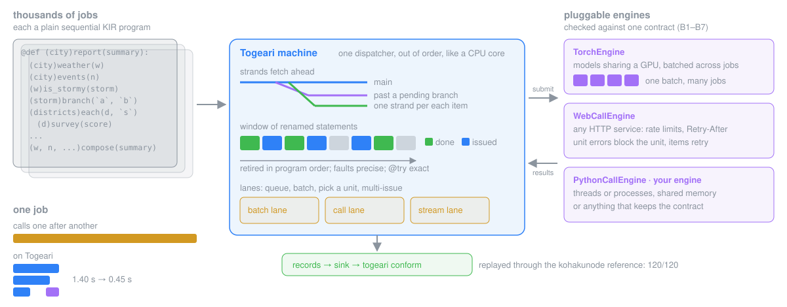

A machine that runs thousands of [KIR](https://github.com/KohakuBlueleaf/KohakuNodeIR) jobs at
once, out of order, on pluggable engines, and checks recorded runs against the reference
interpreter.

A KIR program describes one job as a plain sequential run: call this node, branch on that
value, loop over these items. Togeari runs many such jobs together the way an out-of-order
CPU core runs a thread. Inside a job it overlaps everything the sequential run cannot tell
apart; across jobs it batches calls to the same engine and keeps every engine unit busy.
`kohakunode`'s reference interpreter defines what each job must produce, and the
conformance checker replays recorded runs through it.

```
$ python examples/parallel/machine.py
part 1: one city, one job
  conformance: 1/1 jobs match the reference
  Kyoto   weather           |###############        |  0.00s
  Kyoto   events            |##########             |  0.00s
  Kyoto   traffic           |############           |  0.00s
  Kyoto   survey north      |#####                  |  0.00s
  Kyoto   survey harbor     |#####                  |  0.00s
  Kyoto   survey old town   |#####                  |  0.00s
  Kyoto   survey west       |#####                  |  0.00s
  Kyoto   survey station    |#####                  |  0.00s
  Kyoto   alert             |               ####### |  0.30s
  summary: storm, 15 events, traffic 0.5, storm warning for Kyoto, district scores [5, 2, 6, 8, 9]
  strands at once (peak): 3
  calls in flight at once (peak): 8
  (a strand ends once it has fetched its code; its calls stay in flight after it)
  one job: 0.45s; the same calls one after another: 1.40s
```

One job of a sequentially written program ([examples/parallel](examples/parallel/report.kir)):
the two `parallel` arms, an independent lookup and five district surveys all run at once;
the surveys do not wait for the storm branch to be decided, and `alert` starts the moment
`weather` returns.

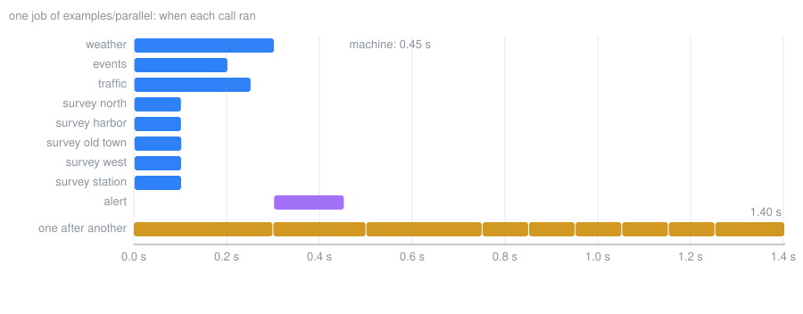

## When to use it

- Many jobs, each a small program of calls to slow things: models on a GPU, HTTP services,
  heavy Python functions. You write one job as plain sequential code; the machine overlaps
  everything that sequential code cannot tell apart, inside a job and across jobs.
- You need the results to be exactly what the sequential code gives. Every recorded job can
  be replayed through the `kohakunode` reference interpreter, and a mismatch names the call.
- Calls of one kind should be batched across jobs (a GPU model wants 64 items at once even
  though each job sends one), and several engine units should share the work and fail over.

It is not a workflow scheduler for long-lived tasks or a cluster manager: one machine is one
Python process with one dispatcher thread, and engines bring their own workers, processes or
servers.

## Concepts

The machine is built like an out-of-order CPU core, with jobs as threads:

| CPU | Togeari | |
|---|---|---|
| thread | job | one run of a KIR entry over one source item |
| instruction | statement | a node call, assignment, branch or loop step |
| program counter | strand | a job's point of fetch; `parallel`, run-ahead and `each` add strands |
| register renaming | value slots | every write gets its own slot, so later writes never disturb earlier readers |
| reorder buffer | window | a job's unfinished statements, retired in program order |
| precise exception | fault | taken at retire in program order; younger work is squashed; `@try` handles it |
| functional unit | engine unit | one worker pool, model or service endpoint |
| issue port | lane | the queue in front of interchangeable units of one engine kind |
| instruction memory | code memory | every loaded program, shared by all jobs; a job carries only addresses |

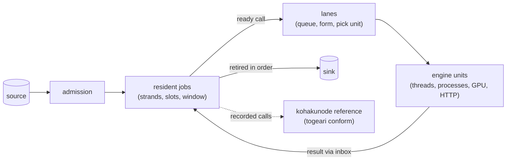

- **Out of order, exactly.** Each job is a thread; each statement an instruction. Writes
  are renamed to value slots, statements issue as soon as their inputs exist, and a per-job
  window retires them in program order. Failures are precise: they are taken in program
  order, younger work is squashed, and `@try` behaves as in the sequential run.
- **Run-ahead without guessing.** A branch whose condition is still being computed parks;
  the code after its reconvergence point keeps going. `each` runs one strand per item.
  Nothing runs on a path the sequential run would not take.
- **One job, many strands; many jobs, one machine.** A job is never split into sub-jobs:
  its strands share one window and one order. Thousands of jobs, of any number of
  programs, share one code memory and one dispatcher.
- **Lanes and multi-issue.** A lane holds interchangeable units of one engine kind (call,
  batch or stream). It queues ready calls from every job, forms batches, picks units by a
  policy, multi-issues to every unit with free capacity, retries on unit errors, fails over,
  times out, and takes units in and out while running.
- **Engines are contracts.** The machine defines what an engine provides and how it
  behaves (B1–B7: `submit` never blocks, exactly one result per item, honest capacity,
  item errors apart from unit errors). `check_engine` and `togeari units` test any engine
  against them. Builtins: `PythonCallEngine` (threads or processes), `WebCallEngine`
  (any HTTP service), `TorchEngine` (models sharing devices under one scheduler).
- **Effects stay in order.** `ordered` nodes run when the sequential run would reach them;
  `mutates` nodes change values in place without older readers seeing it.
- **Plugins at every seam.** Admission, submit, results, faults, the sink, unit state, the
  event bus, queries and commands. Counters, the run report, the trace, the conformance
  recorder, the HTTP inspector and the budget are ordinary plugins.
- **Inspectable and supervised.** Queries and commands go through the dispatcher's inbox
  and see one consistent state. A failing job fails alone, a failing plugin is disabled, and
  a dead dispatcher answers every caller instead of hanging.
- **Proof.** Every node call of a recorded job is kept in retire order;
  `togeari conform` replays it through `kohakunode`, and `--reexecute` runs chosen nodes
  again to catch a result delivered to the wrong statement.
- **Two cores, one protocol.** The dispatcher is written twice: in Python, the reference, and
  in Rust (`togeari._rs`, in every wheel), which makes the same decisions in the same order
  1.9–5.1× faster and leaves the GIL to engine threads while it waits. The Rust core runs by
  default; `core="python"` runs the reference ([speed](#speed-the-python-and-rust-cores)).

## Install

```
pip install togeari              # core (kohakunode >= 0.2.2)
pip install "togeari[web]"       # WebCallEngine (httpx)
pip install "togeari[torch]"     # TorchEngine
pip install "togeari[vault]"     # KohakuVault store, source and sink
pip install "togeari[report]"    # zstd-compressed run report events
```

Wheels cover CPython 3.10–3.14 on Linux x86_64 / aarch64, Windows x64 and macOS arm64; each
carries the native extension `togeari._rs`, so the Rust core runs with nothing more to install.
Elsewhere pip builds the sdist, which needs a Rust toolchain (`rustup`). From a clone (Windows
PowerShell or bash), also with a Rust toolchain to build the extension:

```
git clone https://github.com/KohakuBlueleaf/Togeari && cd Togeari
uv venv -p 3.12
uv pip install -e ".[web,vault,dev]"     # add torch from the index matching your driver
togeari doctor
```

`togeari doctor` prints versions, the core a machine runs, devices and any leftover worker
processes. A machine runs the native Rust core when the extension is built and the Python
core, the reference, otherwise (`core="auto"`); `Machine(core="python" | "rust")` (or
`TOGEARI_CORE=python|rust`) picks one, and asking for `"rust"` without the extension is a
construction error ([native core](docs/internals/native/README.md)). Both make the same
decisions in the same order.

## Quick start

A machine is a program, its node library, and where each node runs:

```python
from pathlib import Path

from kohakunode import NodeLibrary

from togeari import Inline, Lane, Machine, Use
from togeari.engines.python import PythonCallEngine
from togeari.io import Iterable, Memory

lib = NodeLibrary("demo")


@lib.node(outputs=["y"])
def slow_double(x: int) -> int:
    return 2 * x


@lib.node(outputs=["total"])
def add_up(ys: list) -> int:
    return sum(ys)


PROGRAM = """
@def (xs: list)main(total):
    ys = []
    (xs)each(x, `one`)
    one:
        (x)slow_double(y)
        (ys, y)append(ys)
    (ys)add_up(total)
"""

work = Lane([PythonCallEngine(workers=4, mode="thread")], name="work")
machine = Machine(
    program=PROGRAM,
    entry="main",
    libraries=[lib],
    bind={"slow_double": Use(work), "add_up": Inline(), "kir.std.*": Inline()},
)
with machine:
    sink = Memory()
    machine.run(Iterable([{"xs": [1, 2, 3]}, {"xs": [4, 5]}]), sink)
    print(sorted(r.outputs["total"] for r in sink.records))
```

It prints `[12, 18]`. Records reach the sink as jobs finish, so their order is not the input
order. Keys are strings (`Iterable` without `key=` gives `"0"`, `"1"`, …), so sort by a value
the job carries, or give `key=`. A `str` program is KIR text; a `Path` is a file.

For a machine module (a file with `build()` returning the machine, a source and a sink),
with the module's folder on `PYTHONPATH` so the CLI can import its node library:

```
togeari check   examples/hello/machine.py              # build, start no unit, print every problem
togeari run     examples/hello/machine.py --report runs/hello
togeari conform runs/hello --lib nodes:lib             # replay every recorded job
togeari conform runs/hello --lib nodes:lib --reexecute compose
togeari decode  examples/hello/hello.kir --entry greet --lib nodes:lib
togeari units   examples/hello/machine.py              # engine behaviour checks on every unit
```

| Command | Does |
|---|---|
| `togeari check MACHINE` | builds the machine without starting a unit and prints every problem |
| `togeari run MACHINE [--limit N] [--report DIR]` | runs the module's source into its sink; with `--report`, a full run report |
| `togeari conform DIR [--lib M:A] [--run ID] [--reexecute NODE] [--no-engine-errors]` | replays recorded jobs through the reference; re-executes the named nodes |
| `togeari decode PROGRAM --entry E [--lib M:A]` | prints the decode tables of one entry |
| `togeari units MACHINE [--unit U] [--rounds N]` | runs the engine behaviour checks (B1–B7) on every unit with samples |
| `togeari doctor` | versions, devices, leftover worker processes |

## Examples

| Example | Shows |
|---|---|
| [`hello`](examples/hello) | `each`, `switch`, `@try` around a slow service; conformance against the reference |
| [`multi_unit`](examples/multi_unit) | one lane, three units of different speed; the fastest goes down and comes back |
| [`trace_replay`](examples/trace_replay) | stream, call and batch lanes side by side on replayed latency samples |
| [`parallel`](examples/parallel) | one job's independent work at once: `parallel` arms, run-ahead past a branch, an `each` fan-out, with a timeline |
| [`mixed`](examples/mixed) | the builtin engines together: an HTTP registry, Python worker processes, a network on `cuda:0`, ordered log writes, every job recorded and conformed |

<!-- examples-output:begin -->
Their output on the release tree (the default core, Rust):

```
$ python examples/hello/machine.py
Ayu: 3 cards ['Hello, Ayu!', 'Konnichiwa, Ayu!', 'Bonjour, Ayu!']
Bao: 4 cards ['Ni hao, Bao!', 'Hola, Bao!', 'Hallo, Bao!', 'Hello, Bao!']
Chi: 1 cards ['Konnichiwa, Chi!']
Dev: 3 cards ['Bonjour, Dev!', '?, Dev!', 'Hello, Dev!']
Eli: 0 cards []
conformance: 5/5 jobs match the reference
5 jobs, 38 node calls in 1.04s

$ python examples/multi_unit/machine.py
40 jobs in 2.10s, wrong results: none
conformance: 40/40 jobs match the reference
lane work: retries 1, units down 1, back up 1
  unit slow    state up    items   84  errors {}
  unit medium  state up    items  171  errors {}
  unit fast    state up    items  225  errors {'SimOutage': 1}

$ python examples/trace_replay/machine.py
60 documents in 1.71s, kept 41
one job at a time, one call at a time: about 40.4s
  lane fetch  submitted   60  batch sizes {}
  lane score  submitted  243  batch sizes {7: 8, 5: 3, 6: 11, 4: 10, 3: 3, 10: 1, 11: 1, 8: 3, 9: 1, 2: 1, 1: 1}
  lane parse  submitted  243  batch sizes {}
conformance: 60/60 jobs match the reference

$ python examples/mixed/machine.py          # an HTTP registry, 8 worker processes, a network on cuda:0
st003: calm/strong    ['calm/strong', 'calm/strong', 'calm/strong', 'calm/strong', 'calm/strong', 'pulse/strong', 'calm/strong']
st004: calm/weak      ['calm/weak', 'calm/weak', 'calm/weak', 'calm/weak', 'calm/weak', 'calm/weak', 'calm/weak', 'calm/weak']
...
... 120 stations, 0 failed
conformance: 120/120 jobs match the reference
ordered log: 0 problem(s)
120 jobs, 5634 node calls in 3.27s

$ PYTHONPATH=examples/mixed togeari conform runs/mixed/report --reexecute features --reexecute classify --reexecute majority
run 20261022-014140-77768-7bd5a8: 120/120 conform; 0 with weak values; 0 weak digests
120/120 jobs conform; 0 with weak values; 0 weak digests
```

In `mixed`, twelve stations are unknown to the registry: their `lookup` fails inside
`@try`, the fault is taken in program order, and the job continues with gain 1.0. Each
station's `note` lines reach the survey log in window order, followed by its verdict,
while the windows themselves are computed out of order.
<!-- examples-output:end -->

## Builtin parts

| Engine | Kind | For |
|---|---|---|
| `PythonCallEngine(workers, mode="thread" \| "process", transport="pickle" \| "shm", imports=)` | call | node functions off the dispatcher; process workers import node libraries at start, restart after a crash, and are killed and replaced when a cancelled item hangs |
| `WebCallEngine(base_url, max_inflight, rate, pool_size, health_path, connect_timeout_s, on_unit_error)` | call | any HTTP service through an adapter (`JsonHttp`); `Retry-After`, 429 / 503 and connections that do not open as unit errors; `on_unit_error` lets the other requests finish (`"block"`) or answers them at once (`"cancel"`); a token bucket |
| `TorchEngine(devices, memory_cap_gb, schedule, isolation)` | batch, one unit per model | models sharing devices: `co_resident`, `swappable`, `priority_streams`; thread or process isolation; allocator cap set before weights load |
| `SimCall` / `SimBatch` / `SimStream` | any | simulated engines with latency models, item errors and outages |

| Policy | Builtins |
|---|---|
| admission | `Fixed(n)`, `TargetLoad(lane, waiting=)`, `MemoryBound(bytes)`, `All(...)` |
| issue order | `Fifo`, `OldestJobFirst`, `DeepestFirst`, `LaneAware`, `HintPriority` |
| batch forming | `SizeOrWait(size, wait_ms)`, `Bucketed(inner, key)`, `Greedy` |
| unit choice | `LeastLoaded`, `Throughput`, `Affinity(key=)`, `RoundRobin`, `ByHint` |

| Plugin | Does |
|---|---|
| `Counters()` | per-second counters: dispatcher, lanes, units, jobs, work |
| `RunReport(path)` | `spec.json`, `env.json`, `metrics.jsonl`, `events.jsonl[.zst]`, records, `summary.json`, written as the run goes |
| `Perfetto(path)` | a trace with a track per unit, lane queue and dispatcher phase |
| `Recorder(path)` | conformance records per run, programs keyed by semantic hash (`RunReport` embeds one) |
| `Inspector(port=0)` | HTTP queries, JSON commands (host / origin checked, a random access token by default) and an event stream |
| `Budget(max_jobs=, max_calls_per_node=, walltime_s=)` | stops admitting or blocks submits past its caps |

The main knobs (the full table, with the debug knobs and the `Machine` arguments, is in
[writing a machine](docs/guides/writing-a-machine.md)):

| Knob | Default | |
|---|---|---|
| `window` | 64 | unfinished statements per job |
| `retire_buffer` | 4096 | done statements waiting to retire, per job |
| `run_ahead` | True | park at a pending branch and continue after it |
| `mutates` | `"copy-if-speculative"` | or `"wait"`, `"copy-always"` |
| `record` | None | the fraction of jobs recorded for conformance |
| `events` | `"sampled"` | or `"all"`, `"counters"` |
| `snapshot_every` | None | retire boundaries between job snapshots |
| `step_budget` | None | instructions a job may execute |
| `plugin_errors` | `"disable"` | or `"log"` |
| `gc_threshold` | `(50000, 20, 100)` | the process collector threshold while running; None keeps the process's own |
| `squash_reuse` | 1024 | results kept per job after a taken fault, reused when the refetched call's inputs match; 0 re-sends |
| `squash_reuse_bytes` | 64 MiB | bytes of those results kept per job; None: no byte cap |
| `gil_offer_us` | None | the Rust core's least time between two GIL offers to other threads; None offers only while it waits for events |

Every knob can change while the machine runs (`machine.command("set_knob", ...)`).

## Speed: the Python and Rust cores

The Rust core makes the Python core's decisions 1.9–5.1× faster. Measured in one run of
`scripts/studies/p8/s8.py --scale full` on one workstation (CPython 3.13, one GPU): every
measurement runs each variant once per round in a rotating order; medians of five rounds
(ceiling) or three (the rest). Every table, the method and the rule that chose the defaults:
[the cores compared](docs/performance/native.md).

**Dispatcher ceiling** (simulated engines that answer at once, so the dispatcher is the only
cost):

| workload | Python core | Rust core | Rust / Python |
|---|---|---|---|
| a chain of inline nodes | 84,445 calls/s (11.8 µs/call) | 431,650 calls/s (2.3 µs/call) | 5.11× |
| a chain of calls on an engine lane | 30,588 calls/s (32.7 µs/call) | 57,184 calls/s (17.5 µs/call) | 1.87× |
| `each` with batched calls | 42,507 calls/s (23.5 µs/call) | 117,849 calls/s (8.5 µs/call) | 2.77× |

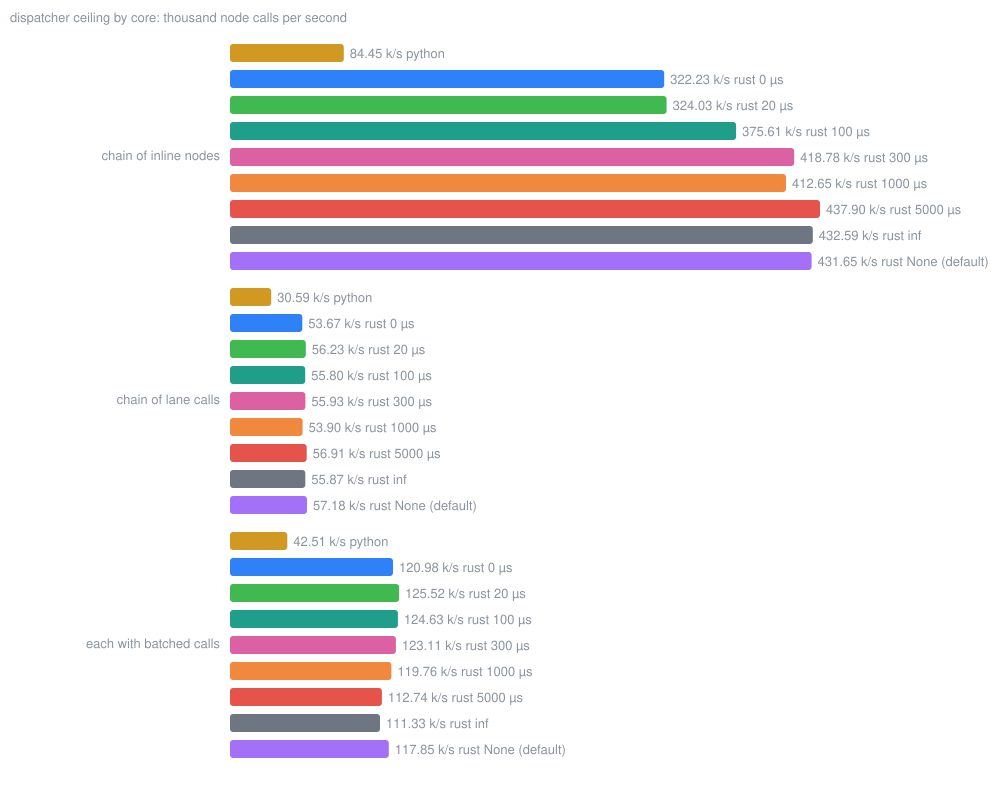

**Scaling** (dispatcher µs per resident job or per `each` item; lower is better):

| shape | Python core | Rust core | Rust, `gil_offer_us=0` | Rust, `gil_offer_us=300` |
|---|---|---|---|---|
| 500 resident jobs | 52.0 | 34.1 | 43.0 | 34.2 |
| 2,000 resident jobs | 52.7 | 39.8 | 41.4 | 32.7 |
| 8,000 resident jobs | 55.5 | 41.5 | 51.0 | 39.2 |
| `each` over 250 items | 82.6 | 34.6 | 56.8 | 33.3 |
| `each` over 1,000 items | 79.5 | 37.6 | 62.9 | 30.1 |
| `each` over 4,000 items | 78.7 | 31.2 | 59.9 | 30.9 |

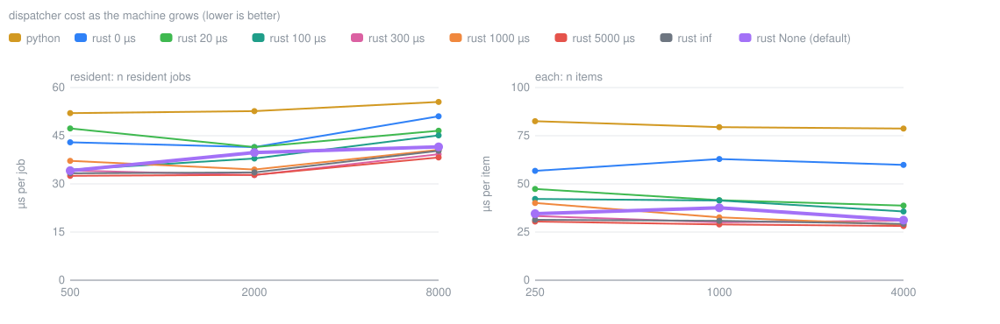

**GIL contention** (an engine fed from its own thread, items/s, while the dispatcher runs a
chain workload paced at 100, 300 and 1000 jobs/s, or at its ceiling):

| engine | core | idle | 100/s | 300/s | 1000/s | ceiling |
|---|---|---|---|---|---|---|
| torch, worker process | Python | 7,395 | 7,474 | 7,449 | 895 | 511 |
| | Rust | 7,344 | 7,372 | 7,398 | 6,884 | 562 |
| | Rust, `gil_offer_us=0` | 7,623 | 7,448 | 7,397 | 7,037 | 1,739 |
| | Rust, `gil_offer_us=300` | 7,676 | 7,576 | 7,268 | 6,987 | 1,970 |
| torch, thread | Python | 8,927 | 6,730 | 5,399 | 767 | 307 |
| | Rust | 8,236 | 7,369 | 6,525 | 3,735 | 409 |
| | Rust, `gil_offer_us=0` | 8,390 | 7,343 | 6,909 | 4,195 | 562 |
| | Rust, `gil_offer_us=300` | 8,441 | 7,089 | 6,269 | 3,274 | 486 |
| Python work, 8 processes | Python | 2,793 | 2,631 | 2,472 | 1,759 | 1,344 |
| | Rust | 2,808 | 2,752 | 2,656 | 2,371 | 1,733 |
| | Rust, `gil_offer_us=0` | 2,843 | 2,665 | 2,617 | 2,254 | 1,806 |
| | Rust, `gil_offer_us=300` | 2,775 | 2,632 | 2,616 | 2,252 | 1,673 |

At its ceiling the Python core runs about 25,000 calls/s and the Rust core about 40,000–47,000,
so the ceiling column compares engines next to a dispatcher doing more work on Rust.

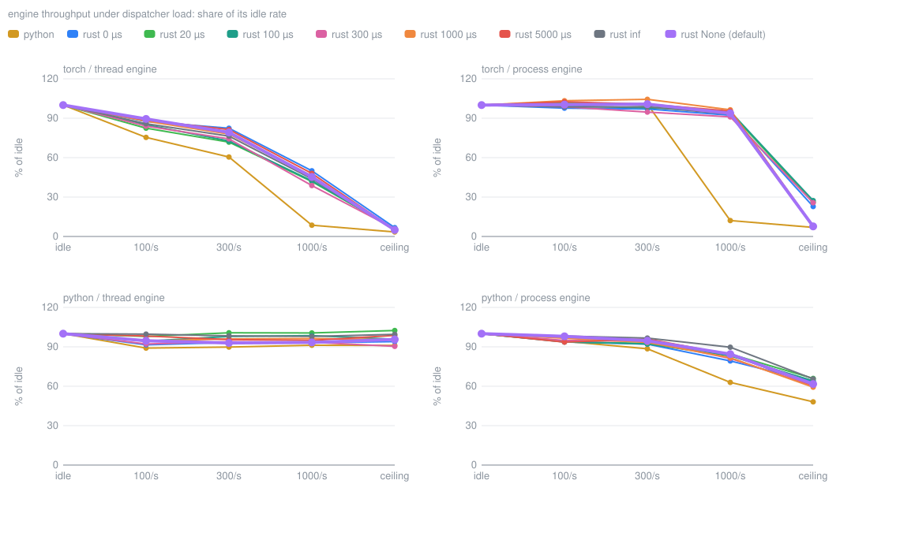

**`gil_offer_us`.** The default, `None`, gives the fastest dispatcher, and below its ceiling the
dispatcher waits for events often enough, releasing the GIL each time, that engine threads run
nearly as if it were idle: a torch network in a worker process keeps 6,884 items/s with the
dispatcher at 1000 jobs/s, against 895 on the Python core. At the ceiling the dispatcher never
waits, so other threads get the GIL only at the interpreter's switch interval (562 items/s).
`gil_offer_us=300` offers it at most every 300 µs of the dispatcher's time and keeps 1,970
items/s there, at a cost of up to 18% to the dispatcher (inline chains with `RunReport`, whose
threads take each offer); `0` offers at every chance and costs up to 45% on those chains.

<!-- measured:begin -->
## Measured

All on one desktop machine with one GPU for the device rows; each block names its method and
the blocks below the Python core's. Full tables: [docs/performance](docs/performance/README.md).

**Dispatcher ceiling, Python core** (`scripts/benches/dispatcher_ceiling.py`: simulated
engines that answer at once, so the dispatcher is the only cost; median of five rounds):

| workload | node calls/s | jobs/s | dispatcher busy |
|---|---|---|---|
| a chain of inline nodes | 78,989 | 3,950 | 0.99 |
| a chain of calls on an engine lane | 28,702 | 1,435 | 0.81 |
| `each` with batched calls | 39,729 | 393 | 0.92 |

With the process's own collector threshold (`gc_threshold=None`), interleaved in the same
rounds: 69,551, 26,872 and 37,393 node calls/s (the default is 6–14% ahead).

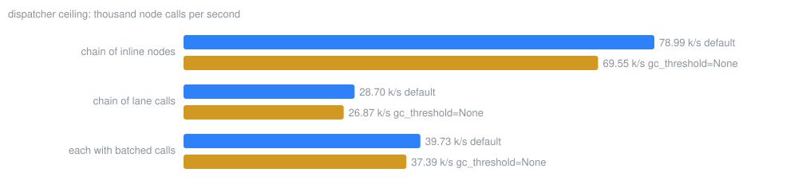

**Cost does not grow with load** (`scripts/benches/scaling.py`, dispatcher µs per job
or per `each` item; the minimum of three runs):

| resident jobs | 500 | 2,000 | 8,000 |
|---|---|---|---|
| µs per job | 54.2 | 55.8 | 56.4 |

| items in one `each` | 250 | 1,000 | 4,000 |
|---|---|---|---|
| µs per item | 77.9 | 78.4 | 82.2 |

A loop iteration costs the same at any count too: 66–87 µs from 250 to 8,000 iterations,
for `jump` loops and repeated `mutates` alike (`tests/scaling`).

**One job against its calls one after another** (`examples/parallel`, regenerated by
`scripts/docs/plots.py`): one job 0.45 s against 1.40 s; four jobs 0.71 s against 4.71 s.

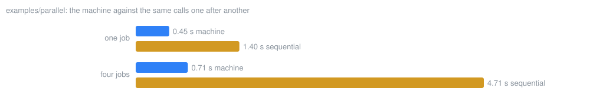

**Engines** (study S1, `scripts/studies/s1/run.py --scale full`, 33 configurations, one run
each):

| measurement | result |
|---|---|
| handoff to a worker process, 1 KB / 2 MB | pipe 183 µs / 4.8 ms; shared memory 59 µs / 1.0 ms |
| pure-Python CPU work, 8 workers | thread 364 items/s; process 2,748 items/s |
| GIL-releasing work, 8 workers | thread 4,035 items/s; process 3,380 items/s |
| a 64 × 1024 network through a lane, dispatcher at 100 jobs/s | thread 4,050 items/s (busy 0.40); process 5,609 items/s (busy 0.63) |
| two models sharing the device (with both / alone) | `priority_streams` 0.53 / 0.95; `co_resident` 0.50 / 0.47; `swappable` 0.17 / 0.11 |
| HTTP client CPU per request | 0.61–0.83 ms; a rate-limited lane holds 100 and 500 requests/s exactly |

The builtin defaults follow these numbers: `PythonCallEngine(mode="thread",
transport="shm")` with shared memory from 1 MiB, `TorchEngine(schedule=
"priority_streams", isolation="thread")`.

**`examples/mixed`** (120 jobs, three engines, every job recorded; one run each): 5,634 node
calls in 4.07 s (29 jobs/s) on the Python core and 3.27 s (37 jobs/s) on the Rust core;
120 / 120 jobs conform in replay and in re-execution.

How measured:

- The ceiling rows are the median of five interleaved rounds; the scaling rows the minimum of
  three runs; S1 and `examples/mixed` one run each. S1 shared the machine with short example
  runs during its first 9 minutes (M1 and the first M2 configurations).
- The benches record nothing and publish events to no subscriber; the examples record
  every job (`record=1.0`) and run `RunReport` where shown, so their times include
  recording (a digest and a copy per call) and event writing.
- "dispatcher busy" is the dispatcher thread's busy fraction: its time outside the inbox
  wait over the run's wall time.
- `tests/scaling` fails when the cost at 4N is above twice the cost at N.
- S1: each phase is a 1 s warm-up then a 2.5 s window; raw JSON and logs in `runs/s1/full/`.
<!-- measured:end -->

## Architecture

Packages under `src/togeari/`:

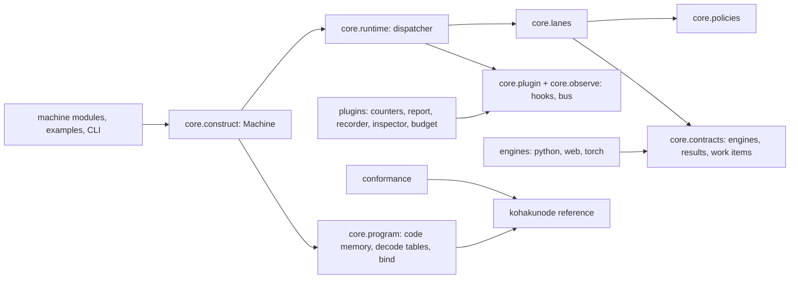

`src/togeari-rust/` is the Rust core (`togeari._rs`): the dispatcher's state, stages and
builtin policies, and native lanes, with modules mirroring `core/`. `core.construct` picks the
core a machine runs; everything around the dispatcher (engines, plugins, stores, the CLI) is
the same Python for both.

A statement's path through the machine:

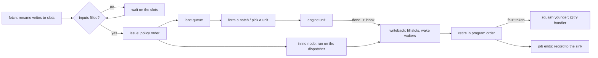

Inside one job: strands share one window and one order key space:

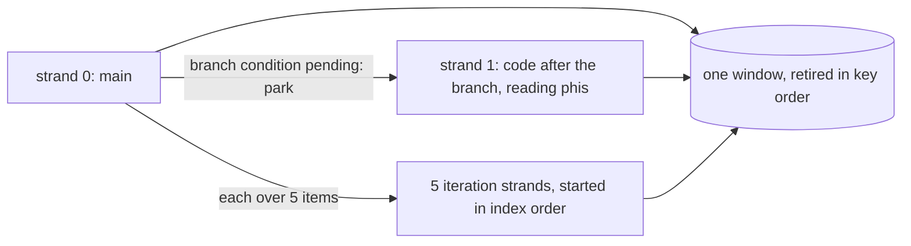

One call across the threads (the dispatcher is the only thread that touches job state):

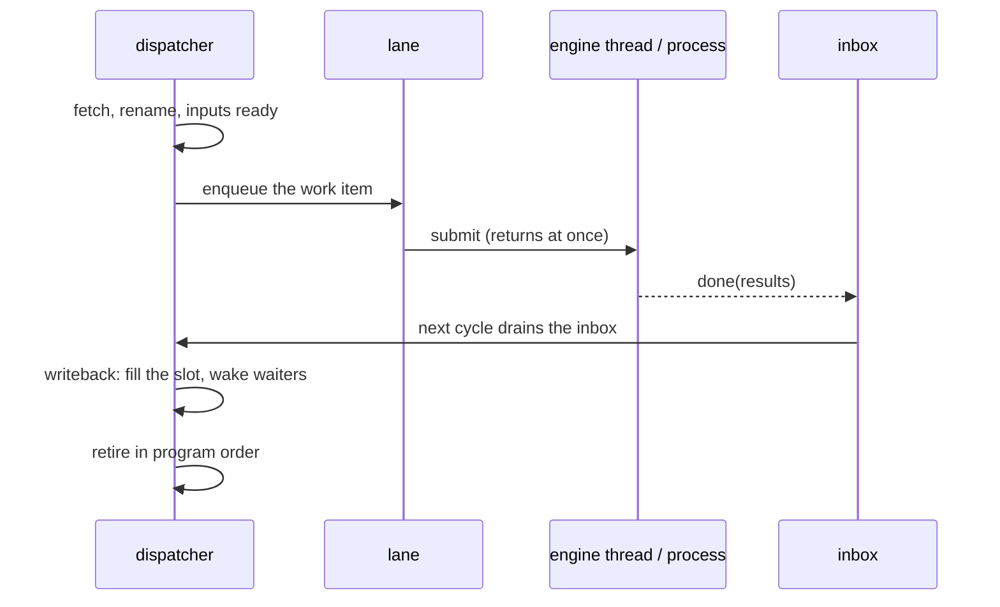

A fault inside `@try`, taken in program order:

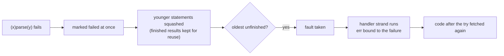

A lane:

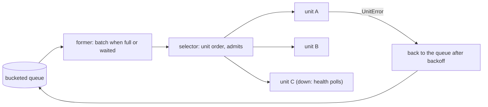

Where plugins hook in:

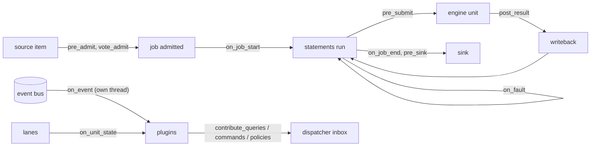

## Documentation

| Where | Read it for |
|---|---|
| [docs/concepts](docs/concepts/README.md) | what the machine is: jobs as sequential runs, the CPU picture, strands, engines and lanes, plugins, the conformance proof |
| [docs/guides](docs/guides/README.md) | writing a machine, an engine, a plugin; the builtin engines; stores, sources and sinks; tuning; conformance; the examples |
| [docs/internals](docs/internals/README.md) | every module: program layer, runtime, lanes, plugins, engines, verification, the native core |
| [docs/performance](docs/performance/README.md) | every measured table and how it was measured; [the cores compared](docs/performance/native.md) |

## Checks

```
python -m pytest tests -q -m "not gpu"                      # CPU only (seeds default 20)
python -m pytest tests -q -m gpu                            # the tests on cuda:0, on their own
TOGEARI_SEEDS=300 python -m pytest tests/machine/generated -q
python scripts/benches/dispatcher_ceiling.py
python scripts/benches/scaling.py
python scripts/studies/s1/run.py --scale full               # thread vs process, transports, GPU sharing
python scripts/studies/p8/s8.py --scale full                # the cores compared, every gil_offer_us
TOGEARI_CORE=python python -m pytest tests -q -m "not gpu"  # the suite on the reference core
```

The generated suite runs programs from `kohakunode.testing.progen` (switch, parallel,
ordered and mutates nodes with aliases, `each` with exits, `@try` around `each`, failing
nodes) under 12 configurations (windows 1 / 64 / 256, injected item errors and unit
outages, early forming, every selector, run-ahead off, every `mutates` mode, a content
store, a pass-through plugin on every hook), several programs in one machine with one
loaded mid-run, snapshot resume and positional reruns; every job is re-executed against the
reference.

## Contributing

Open an issue first for a feature. The code conventions are in [CLAUDE.md](CLAUDE.md):
black and ruff at line length 100, no imports inside functions, nested folders, short
comments that say what the code does, docs that describe what exists, and every check able
to fail on a broken implementation. Run the checks above before a pull request.

## License

Apache-2.0.
